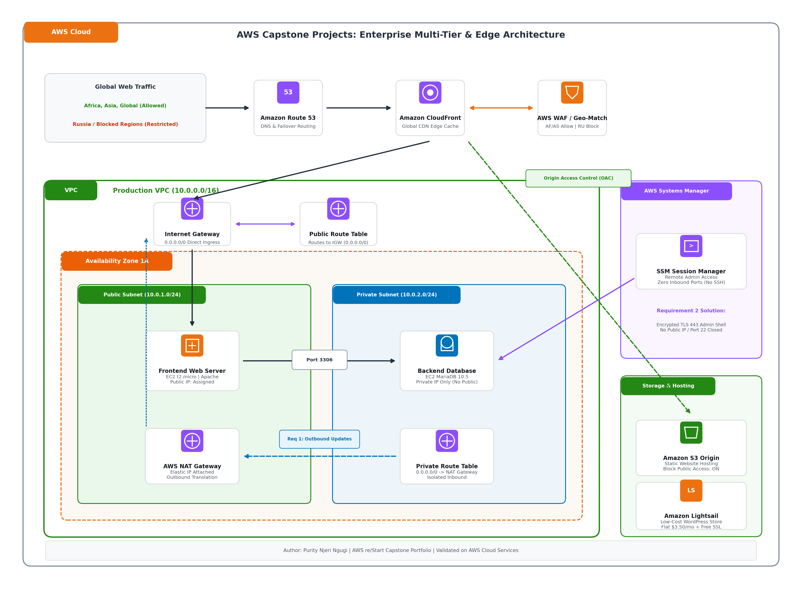
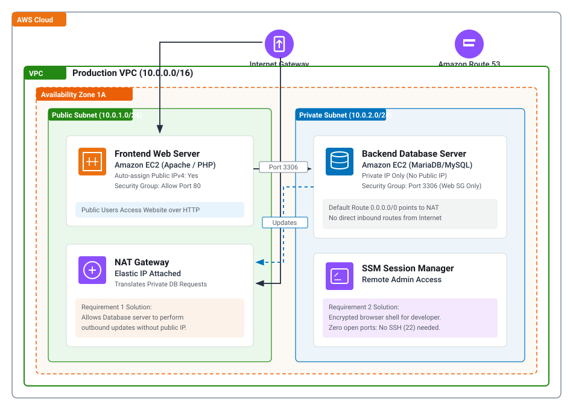

# AWS Cloud Architecture Portfolio
**Author:** Purity Ngugi 

**Focus:** Cloud Architecture, Security, VPC Networking and Cost Optimization  

---

## Architecture Overview

This portfolio contains enterprise cloud infrastructure solutions designed and deployed on Amazon Web Services (AWS). The solutions demonstrate VPC network segmentation, edge geographic access policies, private database security, and cost-effective content distribution.

### Master Cloud Architecture Diagram
The projects follow AWS Well-Architected Framework principles, implementing multi-tier separation, private subnets, edge security, and high availability patterns:



### Implemented Two-Tier Subnet & NAT Routing Architecture
Below is the technical architecture implemented for private database isolation, NAT Gateway routing, and zero-inbound-port remote administration:



---

## Repository Structure

```
aws-capstone-portfolio/
├── docs/
│   ├── generate_architecture_diagram.py      # Python script to generate high-res architecture PNG
│   └── images/
│       ├── capstone-portfolio-architecture.png # Complete AWS capstone architecture diagram
│       ├── two-tier-architecture.svg         # Implemented two-tier VPC & NAT diagram
│       └── s3-cloudfront-architecture.svg    # CloudFront edge & geo-restriction diagram
│
├── project-1-ecommerce-georestriction/
│   ├── README.md                             # Step-by-step console guide & VPN test instructions
│   ├── index.html                            # Clean AfriAsia Mart e-commerce template (SVG icons)
│   └── user-data.sh                          # EC2 bootstrap script for web server setup
│
├── project-2-twotier-vpc-nat-ssm/
│   ├── README.md                             # Architecture, NAT routing & SSM session manager
│   └── two-tier-vpc.yaml                     # AWS CloudFormation Infrastructure-as-Code template
│
├── project-3-s3-cloudfront-geoblocking/
│   ├── README.md                             # S3 + CloudFront CDN guide, OAC policy & Russia block
│   └── website/                              # Conference website static assets
│       ├── index.html
│       ├── style.css
│       ├── app.js
│       └── error.html
│
└── project-4-wordpress-lightsail/
    ├── README.md                             # Lightsail setup, custom DNS & Let's Encrypt SSL
    └── setup-wordpress-ec2.sh                # EC2 Free Tier automated LAMP alternative script
```

---

## Projects Summary

### [Project 1: Geo-Restricted E-Commerce Website (Africa & Asia Only)](./project-1-ecommerce-georestriction/README.md)
* **Requirement:** Host an e-commerce website on Amazon EC2 with a custom domain, accessible only within Africa and Asia.
* **AWS Services:** Amazon EC2, Amazon CloudFront, AWS WAF, Amazon Route 53.
* **Technical Solution:** Configured CloudFront with AWS WAF geo-match rules at the edge to inspect incoming request country codes and drop unauthorized requests (HTTP 403) before traffic reaches the origin EC2 instance.
* **Validation:** Verified via VPN nodes in Kenya/Singapore (200 OK) vs. USA/Germany (403 Forbidden).

---

### [Project 2: Secure Two-Tier Web Application (Public Web + Private DB)](./project-2-twotier-vpc-nat-ssm/README.md)
* **Requirement:** Deploy a public web server and a private database instance. The database must download internet updates without a public IP, and developers must have secure remote administrative access.
* **AWS Services:** Amazon VPC, Public & Private Subnets, Internet Gateway, NAT Gateway, AWS Systems Manager (SSM) Session Manager.
* **Technical Solution:** 
  1. Configured private route tables with default route `0.0.0.0/0` targeting an **AWS NAT Gateway** in the public subnet for outbound-only patch downloads (`dnf update`).
  2. Implemented **AWS Systems Manager Session Manager** with IAM role `AmazonSSMManagedInstanceCore` for developer shell access with **zero open inbound ports** (Port 22 SSH and Port 3306 remain completely closed to the internet).
* **Automation:** Complete stack deployable via reusable **CloudFormation template** (`two-tier-vpc.yaml`).

---

### [Project 3: S3 Static Website with CloudFront (Restricting Russia)](./project-3-s3-cloudfront-geoblocking/README.md)
* **Requirement:** Deploy a high-performance static website on Amazon S3 with Amazon CloudFront, blocking access from Russia.
* **AWS Services:** Amazon S3, Amazon CloudFront, Origin Access Control (OAC), CloudFront Geographic Restrictions.
* **Technical Solution:** Enforced complete S3 origin privacy by blocking public access and allowing reads exclusively via CloudFront Origin Access Control (OAC). Enforced an edge geographic blocklist for country code `RU`.
* **Validation:** Verified global delivery and confirmed HTTP 403 error response when accessing through Russian VPN endpoints.

---

### [Project 4: Low-Cost WordPress Site with Custom Domain](./project-4-wordpress-lightsail/README.md)
* **Requirement:** Deploy a user-friendly, low-maintenance WordPress e-commerce website with minimal development cost and a custom DNS domain.
* **AWS Services:** Amazon Lightsail, Route 53 DNS, Let's Encrypt SSL (`bncert-tool`), WooCommerce.
* **Technical Solution:** Provisioned an Amazon Lightsail WordPress bundle ($3.50/month flat pricing), attached a Static IP, configured DNS routing, and automated Let's Encrypt SSL certificate issuance.

---

## Git Deployment

```bash
git init
git add .
git commit -m "feat: AWS re/Start cloud architecture portfolio"
git branch -M main
git remote add origin https://github.com/<YOUR-USERNAME>/aws-capstone-portfolio.git
git push -u origin main
```
