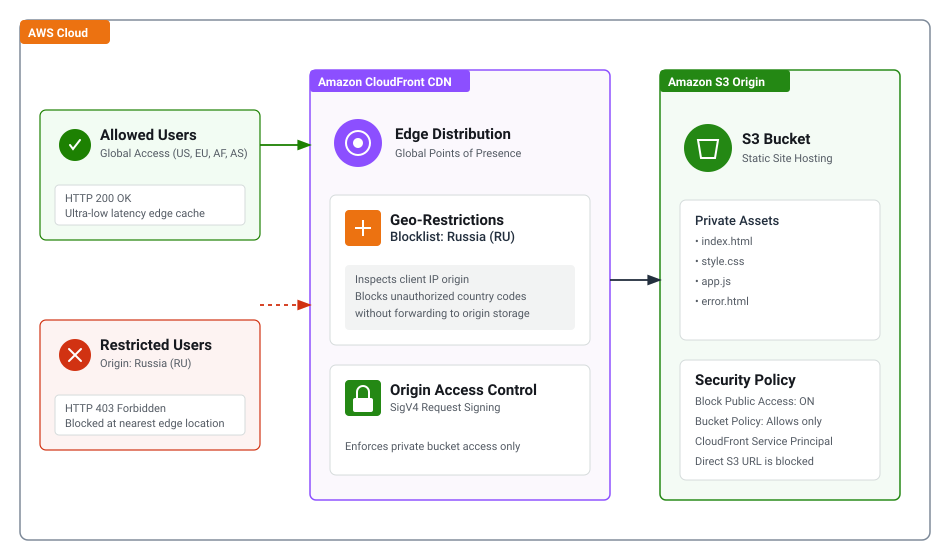

# Project 1: Geo-Restricted E-Commerce Website on AWS EC2

## Project Overview
An international e-commerce startup requires hosting their shopping platform on **Amazon EC2** with a custom domain. The platform must **only** be accessible to users located within the **Africa and Asia** continents. Requests originating from any other continent must be blocked automatically at the edge.

---

## Architecture Diagram



```
[Users in Africa & Asia] ---------> Route 53 (DNS) ---------> CloudFront + WAF ---------> EC2 (Apache) [200 OK]
[Users in Other Continents] ------> Route 53 (DNS) ---------> CloudFront + WAF ---------> [403 Forbidden]
```

---

## AWS Services Used
* **Amazon EC2**: Hosts the web server and application files.
* **Amazon CloudFront**: Provides edge caching, SSL/TLS termination, and geographic inspection.
* **AWS WAF**: Evaluates incoming request country origins against allowlisted continent rules.
* **Amazon Route 53**: Resolves custom DNS domain routing to the CloudFront distribution.
* **AWS Security Groups**: Restricts inbound HTTP/HTTPS traffic to CloudFront IP ranges.

---

## Step-by-Step Implementation

### Step 1: Launch the EC2 Web Server
1. Navigate to **EC2** -> **Launch Instance**:
   * **Name:** `Ecommerce-WebServer-AfricaAsia`
   * **AMI:** Amazon Linux 2023 AMI
   * **Instance Type:** `t2.micro` (or `t3.micro`)
   * **Network Settings:**
     * Auto-assign Public IP: **Enable**
     * Security Group: Allow **HTTP (Port 80)** from `0.0.0.0/0`
   * **Advanced Details -> User Data:**
     Paste the contents of `user-data.sh`.
2. Click **Launch Instance**.
3. Open `http://<EC2-PUBLIC-IP>` in your browser to confirm the web server is running.

---

### Step 2: Create CloudFront Distribution
1. Navigate to **CloudFront** -> **Create distribution**:
   * **Origin Domain:** Select your EC2 instance's Public DNS.
   * **Protocol:** **HTTP only** (between CloudFront and EC2).
   * **Viewer Protocol Policy:** **Redirect HTTP to HTTPS**.
   * **Allowed HTTP Methods:** `GET, HEAD, OPTIONS`.
2. Click **Create distribution** and wait for deployment to complete.

---

### Step 3: Configure Geographic Restrictions

#### Option A: Built-in CloudFront Geographic Restriction
1. Open your CloudFront distribution -> **Geographic restrictions** -> **Edit**.
2. Select **Allowlist**.
3. Select the African and Asian target countries (e.g., Kenya `KE`, South Africa `ZA`, Nigeria `NG`, Egypt `EG`, India `IN`, Japan `JP`, Singapore `SG`).
4. Click **Save changes**.

#### Option B: AWS WAF Geo-Match Rule
1. Open **AWS WAF & Shield** -> Select Region: **Global (CloudFront)**.
2. Create a Web ACL and associate it with the CloudFront distribution.
3. Add a Rule with a **Geo-match statement**:
   * Country origins: Select countries in Africa and Asia.
   * Action: **Allow**.
4. Set default action to **Block (403 Forbidden)**.

---

### Step 4: Map Custom Domain (Route 53)
1. In **Route 53 Hosted Zones**, create an **A-Record**.
2. Toggle **Alias** -> Select **Alias to CloudFront distribution**.
3. Choose your distribution domain name and save.

---

## Demonstration & Verification (Proof of Testing)

### Test 1: Access from Allowed Region (Africa / Asia)
1. Connect via normal local connection or VPN set to **Kenya** or **Singapore**.
2. Browse to the CloudFront distribution domain.
3. **Result:** Page returns HTTP `200 OK` and loads the storefront.
4. *Screenshot Evidence:* Capture the browser displaying the page alongside the VPN location indicator.

### Test 2: Access from Blocked Region (Europe / North America)
1. Switch VPN connection to **United States** or **Germany**.
2. Refresh the page in an Incognito window.
3. **Result:** Page returns `403 Forbidden` generated by CloudFront.
4. *Screenshot Evidence:* Capture the `403 Forbidden` error page with the VPN client active.

---

## Resource Clean-up
1. **CloudFront:** Disable the distribution, then delete it.
2. **EC2:** Terminate `Ecommerce-WebServer-AfricaAsia`.
3. **Route 53:** Remove the test alias DNS record.
