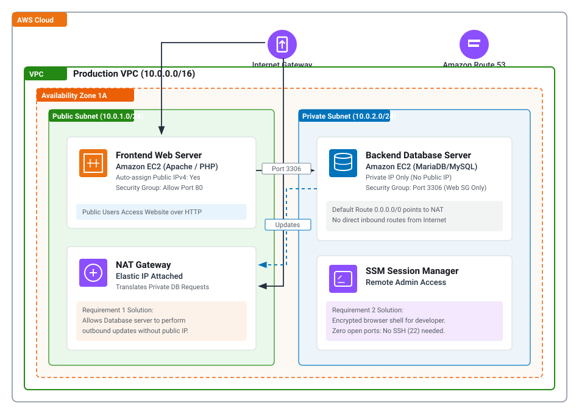
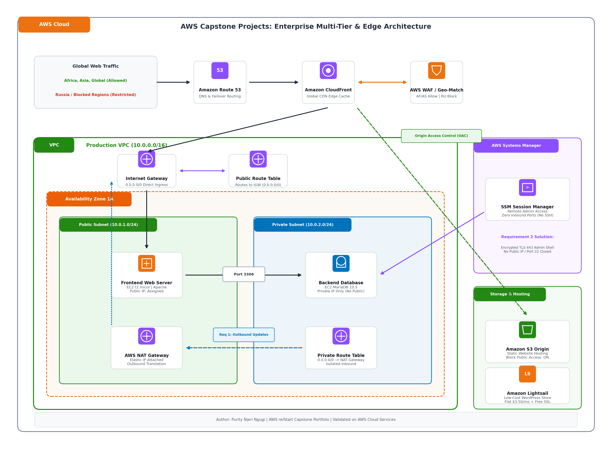

# Project 2: Secure Two-Tier Web Application (Public Web + Private Database with NAT & SSM)

## Project Overview
A startup requires a secure two-tier web architecture on AWS:
1. **Frontend Tier:** Web server accessible to public internet traffic.
2. **Backend Tier:** Database hosted on an EC2 instance in a private subnet with **no public IP address**.
3. **Requirement 1:** Allow the database server to safely download software updates and security patches from the internet.
4. **Requirement 2:** Allow developers to gain secure remote administrator access to the database server without exposing it to public internet threats.

---

## Architecture Diagram



### Enterprise Multi-Tier Architecture Diagram
The architecture is designed following the AWS Reference Architecture pattern for multi-tier applications:



```
[Users] -------------> Internet Gateway -------------> Public Subnet (Frontend Web Server)
                                                               |
                                                          (Port 3306)
                                                               v
[Developer (SSM)] ----> AWS Systems Manager ---------> Private Subnet (Backend Database)
                                                               |
                                                          (Outbound Updates)
                                                               v
                                                       Public Subnet (NAT Gateway) ---> Internet Gateway
```

---

## Solutions Explained

### Solution to Requirement 1: Database Updates from the Internet
* **Challenge:** The database instance is located in a private subnet without a public IPv4 address to prevent inbound internet attacks. It still requires outbound connectivity to download packages (`dnf update`, security patches).
* **Architecture Solution:** An **AWS NAT Gateway** is deployed in the **Public Subnet** and allocated an Elastic IP.
* **Routing:** In the Private Subnet's route table, the default route `0.0.0.0/0` is directed to the **NAT Gateway**.
* **Security Benefit:** Outbound traffic from the database is allowed, but external entities cannot initiate any inbound connection to the private database.

### Solution to Requirement 2: Remote Developer Administrator Access
* **Challenge:** Developers need shell access to the database server, but exposing Port 22 (SSH) or Port 3306 (MySQL) to the public internet presents a significant security risk.
* **Architecture Solution:** **AWS Systems Manager (SSM) Session Manager**.
  * The IAM role with policy `AmazonSSMManagedInstanceCore` is attached to the database instance.
  * Developers initiate secure, encrypted sessions directly through the AWS Management Console or AWS CLI.
  * **Zero inbound ports:** Port 22 and port 3306 remain completely closed to the internet.
  * Every session command is audited in **AWS CloudTrail**.

---

## Step-by-Step Implementation Guide

### Option A: 1-Click Automated CloudFormation Deployment
1. Navigate to **CloudFormation** in the AWS Console.
2. Click **Create stack** -> **With new resources (standard)**.
3. Choose **Upload a template file** and select `two-tier-vpc.yaml`.
4. Name the stack: `TwoTier-App-Stack`.
5. Acknowledge IAM resource creation and click **Submit**.
6. Deployment finishes in approximately 3 to 4 minutes.
7. Retrieve the `WebServerURL` and `DatabaseInstanceId` from the **Outputs** tab.

---

### Option B: Step-by-Step Manual Console Setup

#### Step 1: Create VPC, Subnets, and Gateways
1. Navigate to **VPC** -> **Create VPC** -> Choose **VPC and more**:
   * Name: `TwoTier`
   * IPv4 CIDR block: `10.0.0.0/16`
   * Availability Zones: `1`
   * Public subnets: `1` (`10.0.1.0/24`)
   * Private subnets: `1` (`10.0.2.0/24`)
   * NAT Gateways: **1 per AZ**
2. Click **Create VPC**.

#### Step 2: Create IAM Role for SSM Session Manager
1. Navigate to **IAM** -> **Roles** -> **Create role**.
2. Select **AWS service** -> Use case: **EC2**.
3. Attach policy: `AmazonSSMManagedInstanceCore`.
4. Name the role: `EC2-SSM-AdminRole` and create.

#### Step 3: Configure Security Groups
1. Navigate to **EC2** -> **Security Groups**:
   * **Web Security Group (`TwoTier-Web-SG`):** Inbound HTTP (Port 80) from `0.0.0.0/0`.
   * **Database Security Group (`TwoTier-DB-SG`):** Inbound MySQL/Aurora (Port 3306) from source `TwoTier-Web-SG`. Do not add Port 22.

#### Step 4: Launch Frontend EC2 Web Server
1. Launch instance in `TwoTier-Public-Subnet`.
2. Auto-assign Public IP: **Enable**.
3. Security Group: `TwoTier-Web-SG`.
4. IAM instance profile: `EC2-SSM-AdminRole`.

#### Step 5: Launch Backend EC2 Database Server
1. Launch instance in `TwoTier-Private-Subnet`.
2. Auto-assign Public IP: **Disable**.
3. Security Group: `TwoTier-DB-SG`.
4. IAM instance profile: `EC2-SSM-AdminRole`.

---

## Verification & Proof of Requirements

### Verification of Requirement 1: Database Outbound Updates via NAT Gateway
1. Open **AWS Systems Manager** -> **Session Manager** -> **Start session**.
2. Select `TwoTier-Backend-Database`.
3. Confirm instance has no public IP:
   ```bash
   curl http://169.254.169.254/latest/meta-data/public-ipv4
   ```
4. Verify outbound repository updates via NAT Gateway:
   ```bash
   sudo dnf check-update
   ```
5. *Screenshot Evidence:* Capture the Session Manager terminal showing successful command execution on an instance with only a private IP.

### Verification of Requirement 2: Developer Remote Admin Access
1. In the Session Manager terminal, access the local database engine:
   ```bash
   sudo mariadb
   ```
2. Execute administrative SQL commands:
   ```sql
   SHOW DATABASES;
   CREATE DATABASE startup_db;
   USE startup_db;
   CREATE TABLE inventory (id INT AUTO_INCREMENT PRIMARY KEY, item VARCHAR(50), qty INT);
   INSERT INTO inventory (item, qty) VALUES ('Server Chassis', 12);
   SELECT * FROM inventory;
   EXIT;
   ```
3. *Screenshot Evidence:* Capture the MariaDB/MySQL prompt showing the created table without open inbound ports.

---

## Clean-up Instructions
1. **CloudFormation Deployment:** Select `TwoTier-App-Stack` and click **Delete**.
2. **Manual Deployment:**
   * Terminate instances: `TwoTier-Frontend-WebServer` and `TwoTier-Backend-Database`.
   * Delete NAT Gateway under **VPC -> NAT Gateways**.
   * Release the Elastic IP under **VPC -> Elastic IPs**.
   * Delete VPC `TwoTier-VPC`.
