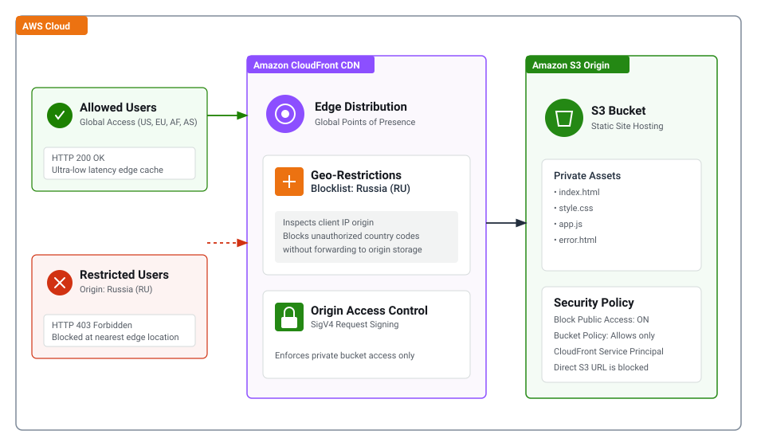

# Project 3: S3 Static Website with Amazon CloudFront & Geographic Restriction (Blocking Russia)

## Project Overview
Deploy a globally accessible static website using **Amazon S3** and **Amazon CloudFront**:
* **Global Performance:** The website must be served through Amazon CloudFront CDN for edge caching and low latency.
* **Security & Compliance:** Direct public access to the S3 bucket is blocked; access is restricted exclusively to CloudFront via Origin Access Control (OAC).
* **Geographic Restriction:** Traffic originating from **Russia** must be blocked automatically at the edge (verified using VPN).

---

## Architecture Diagram



```
[Global Users (Allowed)] -------> Amazon CloudFront (Edge Cache) ------> Amazon S3 (Private Bucket / OAC) [200 OK]
[Russia Users (Blocked)] -------> Amazon CloudFront (Geo Blocklist) ----> [403 Forbidden]
```

---

## AWS Services Used
* **Amazon S3**: Stores static website files (`index.html`, `style.css`, `app.js`, `error.html`).
* **Amazon CloudFront**: Edge caching distribution with global Points of Presence.
* **Origin Access Control (OAC)**: SigV4 request signing ensuring S3 only serves requests authorized by CloudFront.
* **CloudFront Geographic Restriction**: Edge-level country blocklist for country code `RU`.

---

## Step-by-Step Implementation Guide

### Step 1: Create Amazon S3 Bucket
1. Open the **Amazon S3** console.
2. Click **Create bucket**:
   * **Bucket name:** Globally unique name (e.g., `purity-cloud-summit-2026-s3`)
   * **Block Public Access:** Keep **Block all public access** enabled.
3. Click **Create bucket**.

---

### Step 2: Upload Website Assets
1. Open the bucket.
2. Click **Upload** -> Upload all files from the `website/` directory:
   * `index.html`
   * `style.css`
   * `app.js`
   * `error.html`
3. Complete the upload.

---

### Step 3: Create CloudFront Distribution with OAC
1. Navigate to **CloudFront** -> **Create distribution**:
   * **Origin domain:** Select your S3 bucket.
   * **Origin access:** Select **Origin access control settings (recommended)** -> Click **Create control setting**.
   * **Viewer protocol policy:** **Redirect HTTP to HTTPS**.
   * **Default root object:** `index.html`.
2. Click **Create distribution**.
3. In the banner prompt, click **Copy policy**.
4. In S3, open your bucket -> **Permissions** -> **Bucket policy** -> **Edit** -> Paste the policy and save.

---

### Step 4: Configure Geographic Restriction (Block Russia)
1. In CloudFront, open the distribution -> **Geographic restrictions** tab.
2. Click **Edit**:
   * Restriction type: **Blocklist**.
   * Add: **Russian Federation (RU)**.
3. Click **Save changes**.

---

## Demonstration & Verification (Proof of Testing)

### Test 1: Global Access (Allowed Region)
1. Open the CloudFront domain (e.g., `https://d1234abcd.cloudfront.net`) from a standard connection or VPN in Kenya, USA, or Singapore.
2. **Result:** Page returns HTTP `200 OK` and renders the CloudSphere interface.
3. *Screenshot Evidence:* Capture the loaded website with the CloudFront URL.

### Test 2: Geo-Restricted Access (Russia VPN)
1. Connect VPN to a server in **Russia (Moscow / Saint Petersburg)**.
2. Open a new private browsing window and navigate to the CloudFront domain.
3. **Result:** Page returns HTTP `403 ERROR`:
   ```
   403 ERROR
   The request could not be satisfied.
   The Amazon CloudFront distribution is configured to block access from your country.
   Generated by cloudfront (CloudFront)
   ```
4. *Screenshot Evidence:* Capture the browser displaying the `403 ERROR` alongside the VPN client showing connected to Russia.

---

## Resource Clean-up
1. **CloudFront:** Disable the distribution, then delete it.
2. **Amazon S3:** Empty the bucket objects, then delete the bucket.
